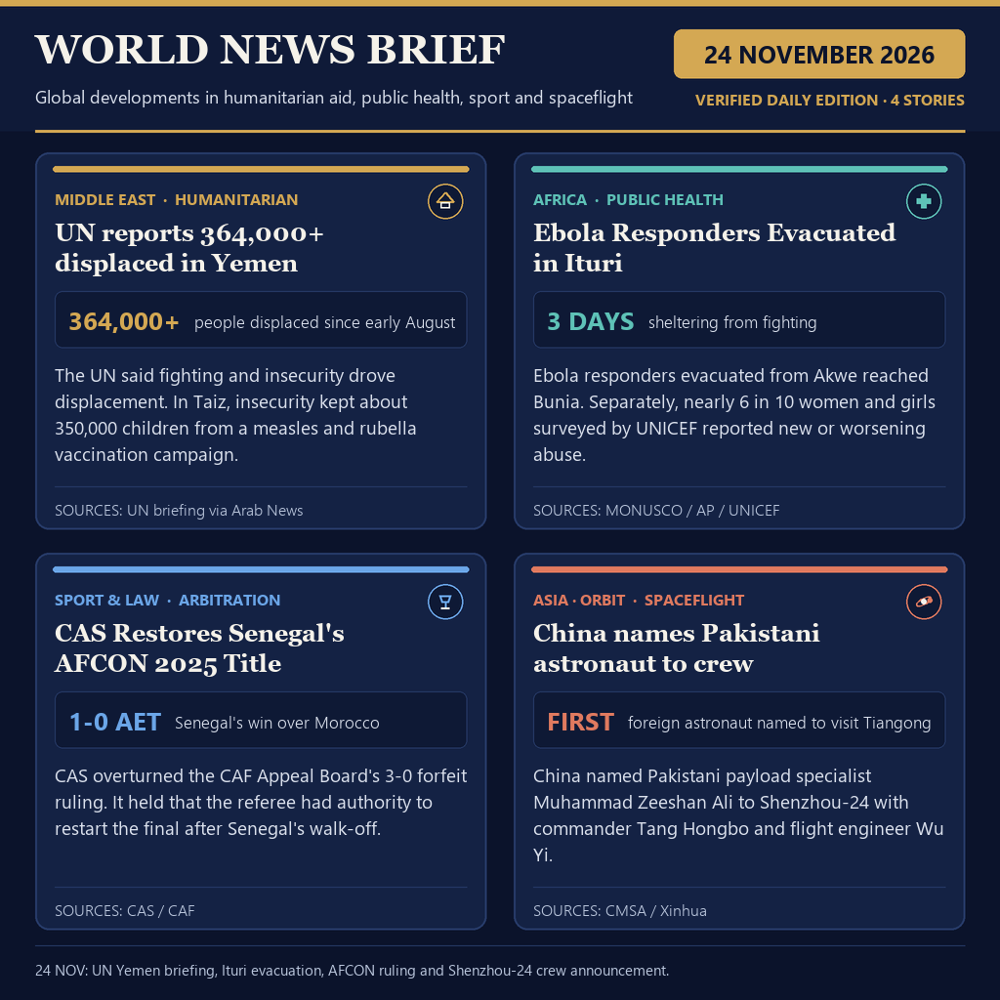

# Chronicle

**v0.1.0 · Single-date infographic generator prototype**

Chronicle turns a curated set of world news stories into a 1024 × 1024 editorial infographic. This release covers 24 November 2026. The [source notes](sources.md) document the reporting behind each story and explain how the dates were verified.



## Installation

Use Python 3.13 on Windows. The renderer uses Pillow 12.2.0 and looks for installed Windows TrueType fonts, including Georgia, Segoe UI, and Arial. From the repository root, run:

```powershell
python -m venv .venv
.\.venv\Scripts\python.exe -m pip install -r requirements.txt
```

## Usage

```powershell
.\.venv\Scripts\python.exe main.py
```

The command renders `news.json` into `output/entry.png`, creating the output directory as needed. The root `entry.png` is the sample shown above. The renderer works offline once Pillow and the fonts are installed.

## Architecture

| File | Role |
| --- | --- |
| `main.py` | Application entrypoint. Runs the renderer and returns its exit status. |
| `render_infographic.py` | Validates the input, lays out the four story cards, and writes a compressed PNG with Pillow. |
| `news.json` | Curated edition date, story copy, statistics, and source labels. |
| `sources.md` | Source links and date verification for the bundled edition. |

## Current limitations

- This prototype ships one manually curated edition. It has no date picker, live feed, or historical retrieval.
- The layout expects exactly four stories and fixed text lengths. Longer copy can fail layout validation.
- Rendering was verified on Windows. Different fonts or Pillow versions can change layout or output bytes.
- The current workflow is a local Python command. Database storage, a web interface, automated tests, and deployment are planned.

## AI-assisted development

The initial renderer was developed with Antigravity CLI. Codex assisted with runtime fixes, checking claims against published sources, and the portfolio conversion. The linked reporting is the evidence for the infographic's claims. Chronicle renders curated data and makes no AI model calls at runtime.

See the [changelog](CHANGELOG.md) and [roadmap](ROADMAP.md). Chronicle is released under the [MIT license](LICENSE).
